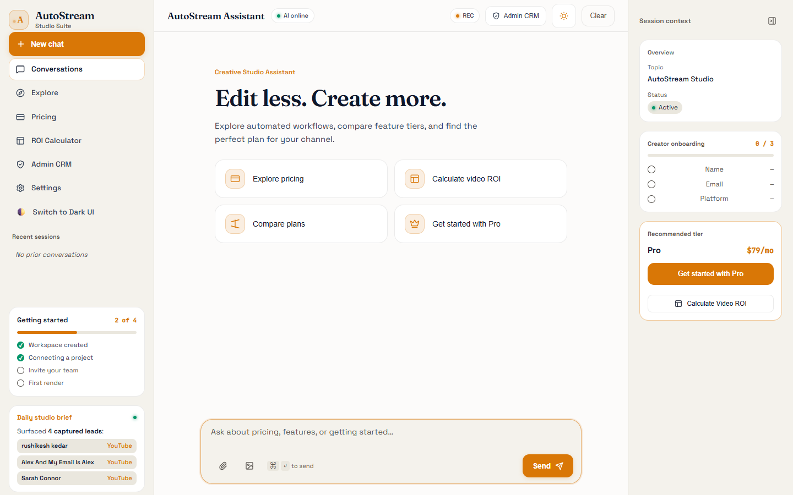
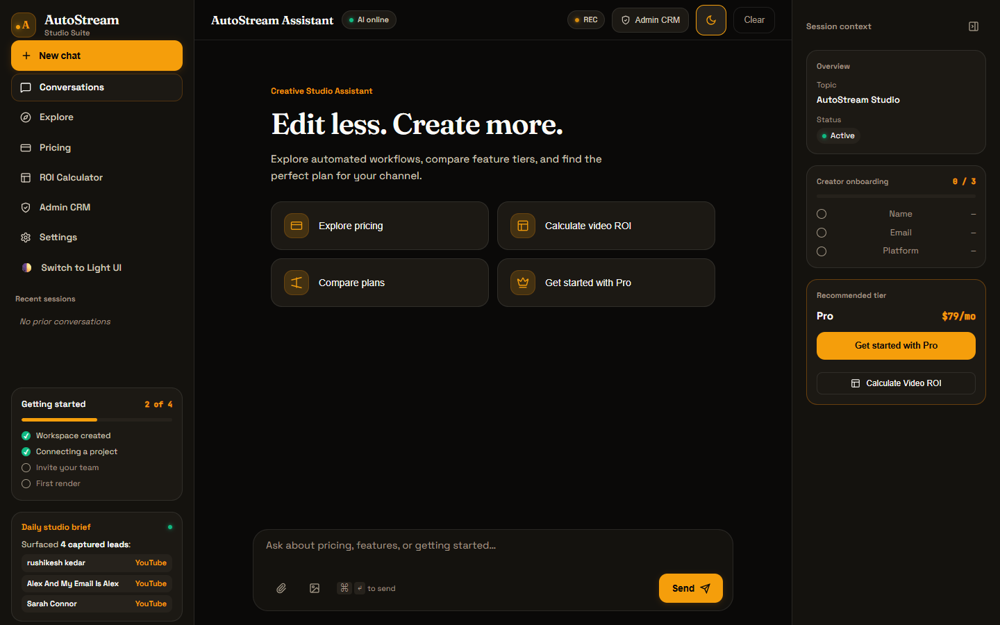
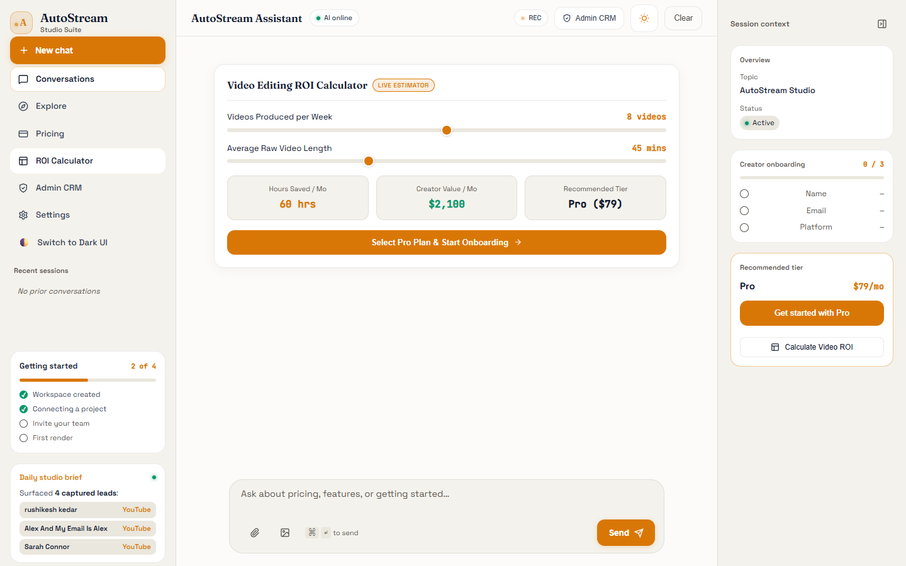
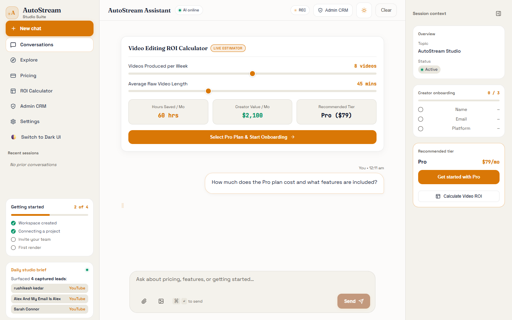
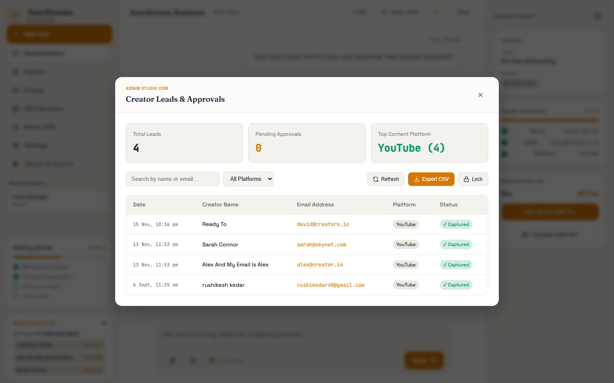
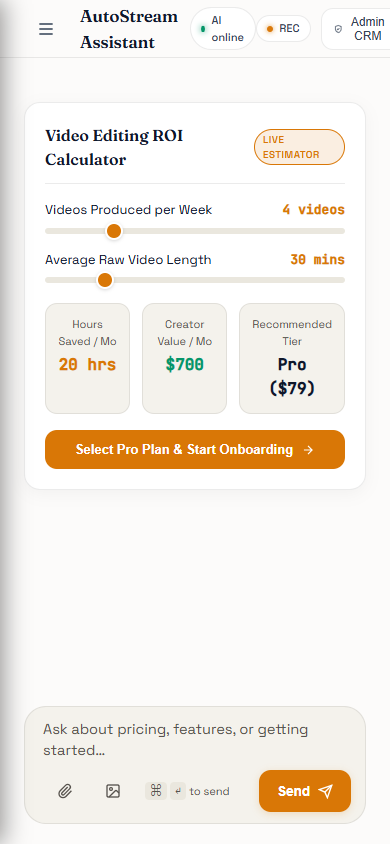

# AutoStream Agent — AI Video Studio Suite

**Demo video:** https://drive.google.com/drive/folders/1rtzM5f_DhSS6CN9Krr4fgQyCOE-T1xGP?usp=sharing

A full-stack conversational AI studio agent designed as an explicit **LangGraph** state machine — featuring multi-turn intent routing, retrieval-augmented answering (RAG over FAISS), structured slot-filling with human-in-the-loop escalation, real-time SSE token streaming, an interactive Video ROI calculator, and a visual Admin CRM dashboard.

The agent sits in front of **AutoStream**, a SaaS platform for automated AI video production (smart captioning, 4K rendering, multi-platform formatting for YouTube, TikTok, Twitch, and Instagram).

---

## Visual Showcase

| Crisp Ivory Light Studio | Dark Obsidian Mode |
| :---: | :---: |
|  |  |

| Interactive Video ROI Calculator | SSE Streaming & Pricing Cards |
| :---: | :---: |
|  |  |

| Visual Admin CRM & Lead Registry | Responsive Mobile Experience (390px) |
| :---: | :---: |
|  |  |

---

## Core Capabilities

- **Intelligent Intent Routing:** Dynamically routes queries between `casual`, `inquiry`, and `high_intent` using LangGraph conditional edges with deterministic fast-paths.
- **RAG Knowledge Retrieval:** Transparent similarity search across the AutoStream knowledge base using local FAISS vector embeddings, complete with verifiable source pills.
- **Robust Multi-Turn Slot Filling:** Captures creator details (`name`, `email`, `platform`) with channel URL detection (`youtube.com/@handle`, `tiktok.com`, `twitch.tv`), preserving conversational context across topic changes.
- **Real-Time Token Streaming:** High-performance Server-Sent Events (`POST /chat/stream`) progressive streaming with fallback to standard `/chat`.
- **Interactive Video ROI Calculator:** In-chat interactive slider tool calculating hours and money saved based on weekly video volume and raw footage length.
- **Visual Admin CRM Dashboard:** Gated by `X-Admin-Token` verification (`/api/admin/verify`), offering real-time search, platform filtering, conversion metrics, and RFC 4180 CSV export (`/api/leads/export`).
- **Human-in-the-Loop Review:** Pauses state execution via LangGraph's `interrupt()` before finalizing lead capture into SQLite (`leads.db`), with dual approval channels (client review cards + admin API).
- **Graceful Fallbacks & High Availability:** Multi-tier model fallbacks (`gemini-2.5-flash` $\rightarrow$ `gemini-2.5-flash-lite`) plus deterministic KB synthesis so zero turns crash even when external API quotas are exhausted.

## Try It

```bash
uvicorn api:app --reload
```

Open **http://127.0.0.1:8000** for the custom Web Studio UI (`static/`) — a vanilla HTML/CSS/JS interface built with Crisp Ivory Light UI (`#fcfbfa`) and Dark Obsidian (`#0a0908`), strictly free of generic blue or neon themes.

Or test via CLI:

```bash
curl -X POST http://127.0.0.1:8000/chat \
  -H "Content-Type: application/json" \
  -d '{"thread_id": "demo-1", "message": "Hi, tell me about your pricing."}'
```

There's also a Gradio UI (`python app.py`, http://127.0.0.1:7860) and a plain
CLI REPL (`python main.py`) if you'd rather not run a browser front end at
all.

## How to Run Locally

You need Python 3.9+ and a free Gemini API key from
[Google AI Studio](https://aistudio.google.com/app/apikey).

**1. Clone the repo and enter the folder**

```bash
git clone https://github.com/Rushi9234/autostream-agent.git
cd autostream-agent
```

**2. Create a virtual environment and install dependencies**

```bash
python -m venv .venv
source .venv/bin/activate          # On Windows: .venv\Scripts\activate

pip install -r requirements.txt
```

**3. Add your Gemini API key**

```bash
cp .env.example .env               # On Windows: copy .env.example .env
```

Open the `.env` file and paste your key after `GOOGLE_API_KEY=`.

**4. Run one of the front-ends above.**

For a quick end-to-end check without typing anything, there's also a scripted
walkthrough:

```bash
python demo.py
```

which runs a fixed example conversation, auto-approves the resulting lead
(see "Human-in-the-Loop Lead Review" below for what that means), and ends
with something like:

```
[Auto-approving demo lead: Alex <alex@example.com>]
Assistant [lead_review]: Perfect, you're all set, Alex! ...
```

That row is now a real one in `leads.db` — query it with `python tools.py`.

> **Free-tier note:** Gemini's free tier caps `gemini-2.5-flash-lite` at a
> small number of requests per day. `demo.py` sleeps between turns to help
> stay under the per-minute limit, but the *daily* cap is separate and much
> harder to work around — if you see `429 ResourceExhausted` errors, that's
> the daily quota, not a bug in this project.

## Project Structure

```
autostream-agent/
├── main.py                   # CLI REPL front-end (incl. lead-approval prompt)
├── app.py                    # Gradio chat UI (local or Hugging Face Spaces)
├── api.py                    # FastAPI wrapper (POST /chat, POST /approve, serves static/)
├── static/                   # custom chat UI (vanilla HTML/CSS/JS, no framework)
│   ├── index.html
│   ├── style.css
│   └── script.js
├── demo.py                   # scripted end-to-end walkthrough
├── eval_intents.py           # intent-classifier accuracy + confusion matrix
├── agent.py                  # LangGraph: state, nodes, routing, HITL, logging
├── rag.py                    # FAISS index (persisted to disk) and retrieval
├── tools.py                  # SQLite-backed lead capture
├── prompts.py                # prompt templates
├── tests/                    # pytest unit tests (no live API calls)
├── knowledge_base/
│   └── autostream_kb.md      # sample pricing, features, policies
├── .github/workflows/
│   └── tests.yml             # CI: runs pytest on every push/PR
├── requirements.txt
├── requirements-dev.txt      # pytest, black, ruff
├── Dockerfile
├── .env.example
├── .gitignore
└── README.md
```

## Frontend

`static/` is a small, dependency-free HTML/CSS/JS chat UI served directly by
`api.py` (`GET /` → `static/index.html`, `/static/*` → the CSS/JS) — no
framework, no build step, no Gradio default theme.

The design is grounded in what AutoStream actually is (automated video
editing) rather than a generic "AI chatbot" look: a dark, flat panel
aesthetic borrowed from NLE software (Premiere/Resolve/Final Cut), a coral
"record dot" instead of a blue status icon, monospace timecodes on every
message, and a timeline-tick divider instead of a plain rule. Both a light
and a dark theme are defined (`prefers-color-scheme`, plus a manual toggle in
the top bar) — the dark theme is closer to how an actual editing suite looks,
the light one for anyone who'd rather not.

It talks to `/chat` and `/approve` with plain `fetch()` calls — open
`static/script.js` to see the whole client; there's nothing hidden behind a
bundler.

## Architecture

The agent is a **LangGraph state machine**. Every turn enters a single
`route_turn` node which classifies the user's latest message into one of
three intents (`casual`, `inquiry`, `high_intent`). Based on that intent, a
conditional edge routes the turn to exactly one handler node:

- `casual_node` — replies briefly to greetings and small talk.
- `rag_node` — does a FAISS similarity search over the markdown knowledge
  base and produces a grounded answer (the prompt explicitly refuses to
  invent prices, features, or policies it can't find in the retrieved
  context).
- `lead_node` — extracts any name/email/platform values from the user's
  message, merges them with whatever's already collected, and either asks
  for what's still missing or, once all three are present, hands off to...
- `escalate_node` — pauses the graph with LangGraph's `interrupt()` and waits
  for a human decision before the lead-capture tool ever fires. See
  "Human-in-the-Loop Lead Review" below.

One detail that isn't obvious from a basic LangGraph tutorial: if we're
already mid-way through collecting lead details, `route_turn` skips
re-classification entirely and stays on the lead path. Without that guard, a
bare reply like `"Alex"` (just a name) gets classified as casual small talk
and the signup flow silently breaks.

**Why LangGraph over a plain prompt loop or AutoGen:** this is a
single-agent workflow with conditional branching and one tool trigger — no
need for multiple agents coordinating with each other (which is what AutoGen
is built for). LangGraph's explicit state schema and graph structure make the
routing logic inspectable and testable in a way a single big prompt isn't.

**State management:** state is a `TypedDict` with four fields — `messages`,
`intent`, `lead_info`, `lead_captured`. Conversation memory is handled by
LangGraph's `SqliteSaver` checkpointer, keyed by a `thread_id` per chat
session, so multi-turn memory (and in-progress signups) survive a process
restart. This replaced the original `MemorySaver`, which kept everything in
process RAM only.

## Human-in-the-Loop Lead Review

Once `lead_node` has collected name, email, and platform, the graph doesn't
call the capture tool itself — it pauses at `escalate_node` via LangGraph's
`interrupt()` and waits for an explicit approve/reject decision. This matters
because "if all 3 fields are present, save it" means the *agent* alone
decides who counts as a customer; a real deployment (or a resume line
claiming "agentic AI") should have a human in that loop for anything that
writes to a real CRM or bills a real card.

While paused, the state (including the pending `lead_info`) is safely
checkpointed to `checkpoints.sqlite` — the process can restart and the thread
resumes exactly where it left off.

- **CLI (`main.py`)**: prompts you right there in the terminal — `Approve
  this lead? [y/n]`.
- **API (`api.py`)**: `/chat` returns `pending_approval: true` and the
  `pending_lead` details instead of finalizing anything; call `POST /approve`
  with `{"thread_id": ..., "approved": true/false}` to resume — this is the
  shape a real admin panel or Slack-button reviewer would call. **Requires an
  `X-Admin-Token` header** matching `ADMIN_TOKEN` (see "Security" below) —
  without that, `thread_id` alone would let anyone approve or reject someone
  else's lead.
- **Custom UI (`static/`) and Gradio (`app.py`)**: auto-approve, since a
  public chat widget has no reviewer UI behind it. This happens **server-side**
  now (`api.py`'s `/chat` handler, gated by `AUTO_APPROVE_DEMO_LEADS`) rather
  than the browser calling `/approve` itself — a public page can't hold the
  admin token without handing it to every visitor.
- **`demo.py`**: auto-approves too, so the scripted walkthrough completes
  unattended, but it goes through the exact same `interrupt()`/resume path.

## Security

A pass looking specifically for security issues (not just correctness)
found one real gap: **`/approve` had no access control** — `thread_id` alone
gated it, so anyone who knew or guessed a thread's ID could approve or reject
someone else's lead over the network. Fixed with an `X-Admin-Token` header
check (`require_admin_token` in `api.py`), backed by an `ADMIN_TOKEN` env var
— if unset, a random token is generated at startup and printed once rather
than the endpoint silently staying open. `tests/test_api.py` covers this.

Also checked and confirmed clean: no secrets anywhere in git history (`git
log --all -p -- .env`), all SQL uses parameterized queries (no string
interpolation, so no injection surface), and the custom frontend
(`static/script.js`) only ever uses `textContent` for user-controlled data —
never `innerHTML`, so no XSS path from a message a user or the agent sends.

`pip-audit` flags several transitive dependencies (mostly via
`langchain`/`langgraph`, a couple of dev-only tools) with known advisories.
Deliberately not blindly bumping those — several are major-version jumps
that would risk breaking the `interrupt()`/`SqliteSaver` code this project
depends on, right after getting it working and tested. The honest thing to
do is flag it as a follow-up task (upgrade on a branch, re-run the full test
suite, verify HITL/checkpointing still work) rather than either ignoring it
or making a risky change without room to verify it.

## What Changed From the First Version

This started as a smaller exercise and I kept coming back to harden it once
the core routing/RAG/extraction logic was working. The main upgrades:

- **Lead capture is real now.** `tools.py` used to just `print()` a string.
  It now writes to a SQLite table (`leads.db`) via `mock_lead_capture()` —
  kept the original function name since `agent.py` calls it unchanged, but
  it's a real persisted row now, not a mock.
- **Conversation memory survives a restart.** Swapped `MemorySaver` (RAM
  only) for `SqliteSaver` (`checkpoints.sqlite`).
- **The FAISS index is cached to disk.** `rag.py` used to rebuild (and
  re-embed) the whole knowledge base on every process start. It now saves the
  index under `index/` and only rebuilds when the KB file's content hash
  changes.
- **LLM calls don't crash the whole turn anymore.** Every call into Gemini
  goes through `agent.invoke_llm()`, which retries transient failures with
  backoff and returns `None` on total failure so each node can fall back to a
  safe default instead of raising.
- **There's an actual evaluation artifact.** `eval_intents.py` runs ~30
  hand-labeled example messages through the intent classifier and reports
  accuracy plus a confusion matrix — see below for how to run it.
- **Three front-ends now, not one.** `main.py` (CLI) was the only way to try
  this. Added `api.py` (FastAPI, for wiring into WhatsApp/Slack/anything
  webhook-based) and `app.py` (Gradio, for a link anyone can click).
- **Basic dev tooling.** `requirements-dev.txt` (pytest/black/ruff) and a
  `tests/` directory covering the routing guard, JSON extraction, retry
  logic, and lead persistence — none of which need a live API key to run.
- **Human-in-the-loop lead review.** The capture tool no longer fires
  automatically — `escalate_node` pauses the graph with `interrupt()` and
  waits for an approve/reject decision. See the dedicated section above.
- **Observability.** Every node logs its name, resulting intent, and latency
  to `agent.log` (see `agent.log_node`); PII (emails) is masked in anything
  that hits stdout/logs, even though the full value is still stored in
  `leads.db`.
- **CI.** `.github/workflows/tests.yml` runs the full `pytest` suite on every
  push/PR — no API key/secret needed since the tests never call a live LLM.
- **Custom frontend and an access-control fix.** Built a dependency-free
  static chat UI (`static/`) instead of relying on a framework's default
  theme, and a security pass found `/approve` had no auth at all — fixed
  with an `ADMIN_TOKEN`-gated header check. See "Security" below.

## Evaluating the Intent Classifier

```bash
python eval_intents.py
```

This runs ~30 hand-labeled example messages (10 per label) through the same
classification path `route_turn` uses, and prints accuracy plus a confusion
matrix, e.g.:

```
Confusion matrix (rows = expected, columns = predicted):
                    casual     inquiry high_intent
casual                  10           0           0
inquiry                  0          10           0
high_intent               0           0          10
```

Note: Gemini's free tier caps requests per day, and this script makes ~30
calls in one run — if you hit a `429`, it's the daily quota, not a failure of
the script. Run it once you've got quota headroom and read off the actual
numbers; I'd rather point you at the script than paste a number here that
might not match what you see with your own key/quota.

## Running Tests

```bash
pip install -r requirements-dev.txt
pytest tests/
```

The test suite covers the routing guard, JSON extraction from LLM output,
the LLM retry/fallback logic, and SQLite lead persistence — all without
hitting a live API, so it runs the same with or without a configured key.

## Deploying

**Render (1-Click Cloud Deployment):**
1. Sign up on [Render.com](https://render.com) (free) and click **New +** $\rightarrow$ **Blueprint**.
2. Connect your `autostream-agent` repository — Render will read [`render.yaml`](render.yaml) automatically.
3. Enter your `GOOGLE_API_KEY` under Environment Variables and click **Apply**.
4. Render deploys the live Web Studio with automatic SSL, `/health` monitoring, and continuous deployment on every git push.

**FastAPI, anywhere that runs Python:**

```bash
uvicorn api:app --host 0.0.0.0 --port 8000
```

**Docker:**

```bash
docker build -t autostream-agent .
docker run -p 8000:8000 --env-file .env \
  -v autostream-leads:/app/leads.db \
  -v autostream-checkpoints:/app/checkpoints.sqlite \
  -v autostream-index:/app/index \
  autostream-agent
```

(those volumes keep captured leads, conversation state, and the FAISS index
across container restarts — without them every container start is a clean
slate)

**Gradio, on Hugging Face Spaces:** push this repo to a new Space with the
Gradio SDK, set `GOOGLE_API_KEY` as a Space secret, and `app.py` is picked up
automatically as the entry point.

## Extending to a Real Channel (e.g. WhatsApp)

To put this behind the WhatsApp Cloud API (webhook-based):

1. **Reuse `api.py`'s shape**, but add two endpoints instead of one:
   - `GET /webhook` for Meta's verification handshake — echo back
     `hub.challenge` if `hub.verify_token` matches what's configured in the
     Meta app dashboard.
   - `POST /webhook` to receive each incoming message (JSON with the
     sender's phone number and message text).
2. **Use the phone number as the `thread_id`.** `api.py` already threads a
   `thread_id` through to the graph's checkpointer — using the sender's
   number as that ID gives every user their own persistent conversation with
   no agent-code changes.
3. **Reply via the WhatsApp Cloud API's messages endpoint**
   (`https://graph.facebook.com/v20.0/<phone_number_id>/messages`) with the
   access token in the `Authorization` header.
4. **Acknowledge the webhook immediately** (200 response) and process the
   message in a background task, since Meta retries webhooks that respond
   slowly.

## Recently Implemented Upgrades

- **Real-Time Token Streaming:** Progressive Server-Sent Events (`POST /chat/stream`) yielding live response tokens to the front end.
- **Visual Admin CRM Reviewer Panel:** Visual modal backed by `GET /api/admin/verify` and `GET /api/leads/export` for real-time lead management, search, metrics, and CSV downloads.
- **In-Chat Video ROI Calculator:** Embedded dynamic estimator for hours saved and subscription value.

## Future Exploration (Out of Scope for Now)

- **Vector DB Scale-out:** FAISS is optimal for this local knowledge base; a distributed backend (e.g. Chroma, Qdrant, or Pinecone) can be attached if the documentation grows to thousands of pages.
- **Voice/Audio Modal:** Real-time speech-to-text input and natural voice audio previews.

## Notes

- The knowledge base is a single markdown file
  (`knowledge_base/autostream_kb.md`), split on markdown headers (H1/H2/H3)
  so pricing, features, and policies become separate retrievable chunks.
  It's intentionally simple/synthetic — swapping in a real document set would
  only touch `rag.py`.
- The lead-capture tool is guarded: it only fires once name, email, and
  platform have all been collected. Until then the agent keeps asking for
  whatever's missing.
- Temperature is set to 0.2 across all nodes to keep replies consistent.
